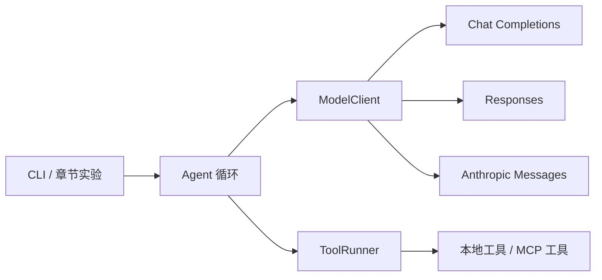

# 教程目录：从一个循环到完整 Agent

minicode 的目标是一个可以读代码、修改文件、运行检查、保存进度并接入外部工具的终端 Agent。你只需要 Python 基础；不要求提前写过聊天机器人，也不要求准备模型密钥。

## 学习路线

| 章节 | 这一章新增什么 | 可运行实验 |
| --- | --- | --- |
| [00 环境与第一次模型交互](00-setup.md) | 请求、回复、工具外部执行的概念 | `examples/00_hello.py` |
| [01 最小 Agent Loop](01-agent-loop.md) | 统一消息与假模型，串行工具往返 | `examples/01_agent_loop.py` |
| [02 工具系统](02-tools.md) | 工具声明、注册、参数校验和统一结果 | `examples/02_tools.py` |
| [03 Chat Completions](03-chat-completions.md) | 第一个真实协议适配器 | `examples/03_chat_completions.py` |
| [04 Responses](04-responses.md) | items、call_id 和原始续轮数据 | `examples/04_responses.py` |
| [05 Anthropic Messages](05-anthropic.md) | 内容块、结果分组、三协议契约测试 | `examples/05_anthropic.py` |
| [06 编码工具](06-coding-tools.md) | 读、写、改、查找、搜索、运行命令 | `examples/06_coding_tools.py` |
| [07 权限](07-permissions.md) | 执行边界、共享审批、只读模式 | `examples/07_permissions.py` |
| [08 流式输出](08-streaming.md) | SSE、事件归一、参数拼装、中断 | `examples/08_streaming.py` |
| [09 上下文](09-context.md) | 项目说明与请求视图 | `examples/09_context.py` |
| [10 会话与压缩](10-sessions-compaction.md) | 恢复、调用修补、派生摘要 | `examples/10_sessions.py` |
| [11 Hooks 与规划](11-hooks-planning.md) | 执行扩展点、计划工具与只读策略 | `examples/11_hooks_planning.py` |
| [12 子 Agent](12-subagents.md) | 独立历史、只读委派、共享预算 | `examples/12_subagents.py` |
| [13 Skills](13-skills.md) | 发现技能、按需读取操作指南 | `examples/13_skills.py` |
| [14 MCP](14-mcp.md) | 把外部协议的工具接入同一执行器 | `examples/14_mcp.py` |
| [15 评测](15-evals.md) | 文件验收、用量预算、失败分类 | `examples/15_evals.py` |
| [16 交付](16-shipping.md) | CLI、配置、打包和干净安装 | `examples/16_shipping.py` |

## 开始之前：环境准备

在仓库根目录执行：

```bash
uv sync --locked
uv run python examples/00_hello.py
```

`uv sync` 按锁文件安装项目本身和开发依赖。示例脚本因此可以导入 `minicode`。不用 `cd` 到 `examples`，也不用手动设置 `PYTHONPATH`。详细排错见[第 00 章](00-setup.md)。

## 怎样使用代码

第一次阅读时，先看每章的实验，再读本章新增模块。[第 01 章快照](../lessons/ch01.py)只依赖标准库，可以从空文件开始手写；[第 02 章快照](../lessons/ch02.py)在它上面提取 `Agent` 与 `ToolRunner`，没有后续章节的流式分支。第 03 章才把类型和循环拆成正式模块并增加协议所需字段，第 08 章再加入流式处理。

后续扩展通过包装器组合：权限包装工具执行器，预算和压缩包装模型，会话在循环外记录内部消息。每章引入一个有用的接点，不必在第二章预先写完所有功能。示例是每章能力的实验，不是十七份复制的完整应用；最终集成入口在第 16 章。

每完成一章，做四件事：

1. 运行本章示例，观察新增的消息或事件。
2. 阅读并实现本章模块，解释它的输入输出。
3. 运行本章测试，再运行已有回归测试。
4. 修改一个条件，例如未知工具、拒绝权限或截断响应，预测并验证结果。

## 始终遵守的边界



- 内部只有 `Message`、`ToolSpec`、`ToolCall`、`ToolResult`、`ModelReply` 等类型。
- 适配器负责协议转换，不执行工具，不决定权限，不写会话。
- Agent 决定继续或停止；工具执行器负责参数验证和调用。
- 会话保存内部历史；模型请求可以使用它的派生视图。
- 服务商续轮数据由适配器保存、核对来源和重放，核心不解释它。

## 阅读开源实现

[参考实现](references.md)固定了 Codex、OpenCode、pi 的版本，并把本教程的模块映射到源码位置。先做出自己的小实现，再阅读对应模块，比较状态、边界和失败处理，不需要先读完整仓库。
