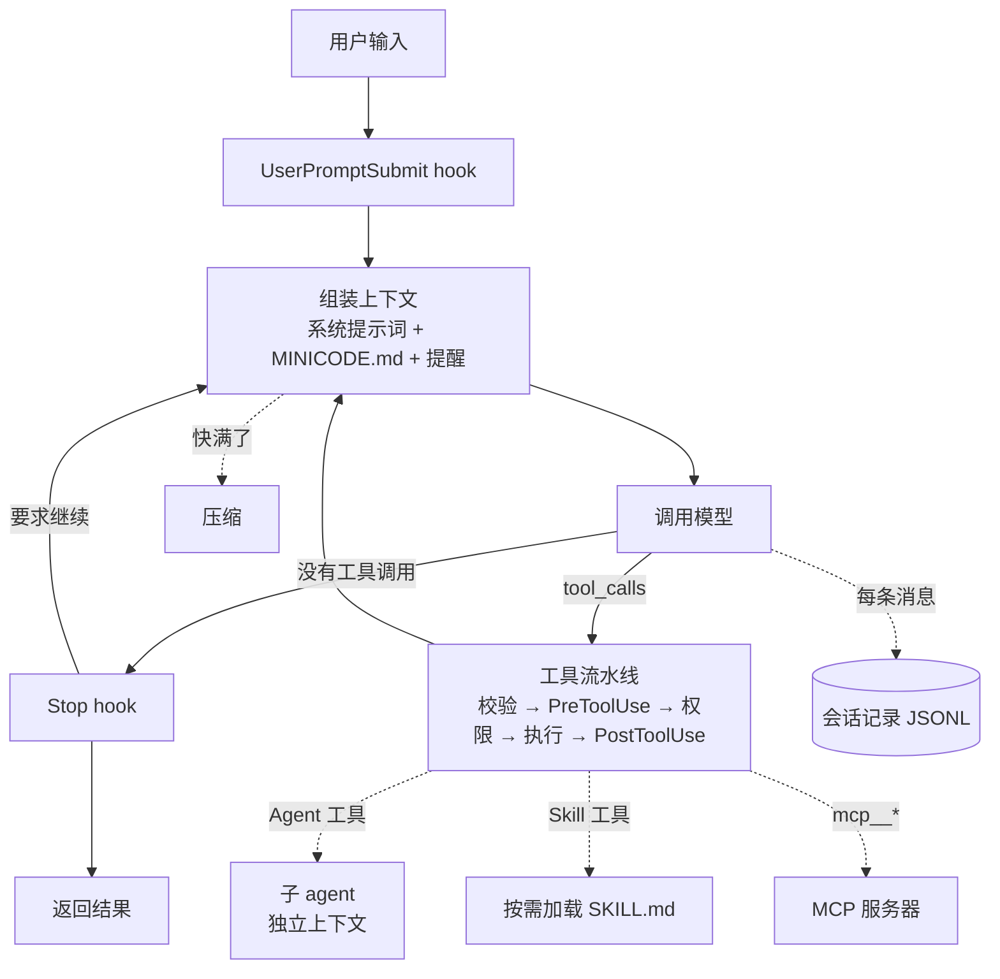

# 照着 Claude Code 写一个 Agent

这套教程拆解 Claude Code 的架构，一边看它怎么做，一边用 Python 从零写出一个能真正干活的 coding agent：**minicode**。

每一章只讲 Claude Code 的一个机制。先看 Claude Code 公开的设计和行为，再写一个最小可用的实现，最后用不联网的测试验证它。十二章写完，你手里会有一个两千来行（含注释）、结构和 Claude Code 对应的 agent：会读写文件、跑命令、问你要权限、记得项目约定、上下文快满时自己压缩、能派子 agent、能加载 skill、能接 MCP 服务器，还有一套评测。

> **核心观点：模型决定想做什么，harness 决定能不能做、看到什么、怎么记录、出错了怎么办。**
> Claude Code 的官方文档把它自己叫作 “agentic harness”：“the layer around the model that provides the tools and manages the context the model sees”。这套教程写的就是这一层。

## 为什么拿 Claude Code 当教材

[Agent Learning Hub](Agent-Learning-Hub.md) 把 “Claude Code / Codex-style coding agents” 和 “Agent harness engineering” 列为当前最值得投入的两个方向。Claude Code 正好同时是这两样东西的样本：

- 它面对的是真实代码库、真实 shell，任何设计缺陷都会立刻暴露出来。
- 它的机制有完整的公开文档（权限、hooks、记忆、子 agent、skills、MCP），可以逐条对照。
- 它的很多行为你每天都能直接观察到：工具说明、权限弹窗、`~/.claude/projects/` 下的会话记录、压缩后的摘要。

学会它的设计，换到别的 agent 框架也能一眼看出各个零件在哪里。

## Claude Code 的骨架，和 minicode 的对应关系



| Claude Code 的机制 | 章节 | minicode 里的文件 |
| --- | --- | --- |
| Agentic loop | [第 1 章](01-agent-loop.md)、[第 2 章](02-tools.md) | `agent.py` |
| 内置工具：Read、Write、Edit、Glob、Grep、Bash | [第 2 章](02-tools.md) | `tool.py`、`tools/` |
| 权限模式和 allow / ask / deny 规则、settings 分层 | [第 3 章](03-permissions.md) | `permissions.py`、`settings.py` |
| Hooks | [第 4 章](04-hooks.md) | `hooks.py` |
| 系统提示词、CLAUDE.md、自动记忆、WebFetch | [第 5 章](05-context.md) | `context.py`、`tools/web.py` |
| 会话记录、`--continue`、上下文压缩 | [第 6 章](06-session-compact.md) | `session.py`、`compact.py` |
| 待办清单、plan 模式 | [第 7 章](07-planning.md) | `tools/planning.py` |
| 子 agent（Agent 工具） | [第 8 章](08-subagents.md) | `subagents.py`、`tools/task.py` |
| Skills 和斜杠命令 | [第 9 章](09-skills.md) | `skills.py`、`tools/skill.py` |
| MCP（含浏览器自动化） | [第 10 章](10-mcp.md) | `mcp_client.py` |
| `-p` 非交互模式、stream-json、预算、评测和安全 | [第 11 章](11-evals-safety.md) | `evals/` |
| 打包、CI、交付 | [第 12 章](12-shipping.md) | `pyproject.toml`、`.github/workflows/` |

## 章节目录

| 章 | 主题 | 学完你能回答 | 对应 Hub 的 Stage |
| --- | --- | --- | --- |
| [1](01-agent-loop.md) | Agent Loop | agent 和聊天机器人差在哪？循环什么时候停？ | Stage 1 |
| [2](02-tools.md) | 工具系统 | 为什么 Edit 要求先 Read？哪些工具可以并行？ | Stage 1、2 |
| [3](03-permissions.md) | 权限系统 | `Bash(git *)` 能不能放行 `git log && rm -rf x`？ | Stage 3、7 |
| [4](04-hooks.md) | Hooks | 怎样在不改 agent 代码的情况下拦住危险命令、强制跑测试？ | Stage 3 |
| [5](05-context.md) | 上下文工程 | 为什么 Claude Code 不给代码库建向量索引？记忆文件放在哪？ | Stage 2 |
| [6](06-session-compact.md) | 会话与压缩 | 进程崩了怎么接着做？上下文满了留下什么、丢掉什么？ | Stage 2、3 |
| [7](07-planning.md) | 规划 | 待办清单为什么要交给 harness 管？plan 模式靠什么保证只读？ | Stage 4 |
| [8](08-subagents.md) | 子 agent | 多 agent 的真正收益是什么？什么时候单 agent 更好？ | Stage 4 |
| [9](09-skills.md) | Skills | skill 和 tool、prompt、MCP 有什么区别？上百个 skill 怎么不撑爆上下文？ | Stage 5 |
| [10](10-mcp.md) | MCP | 一个 MCP 工具调用在线路上长什么样？怎么安全地让 agent 操作浏览器？ | Stage 5、6 |
| [11](11-evals-safety.md) | 评测、可观测性与安全 | 改了提示词，怎么知道变好还是变坏？提示词注入怎么防？ | Stage 6、7 |
| [12](12-shipping.md) | 交付 | 别人怎么装、怎么配、怎么在 CI 里用你的 agent？ | Stage 8 |

每一章的结构都一样：**导读 → Claude Code 是怎么做的 → 动手实现 → 跑起来 → 离线测试 → 和 Claude Code 的差别 → 自检清单、常见坑、进阶练习、资料来源**。

怎么读：

- 刚入门：从第 1 章顺着做。每章都在上一章的代码上加东西，跳着做会缺文件。
- 已经写过工具调用循环：快速看完第 1 章，从第 2 章开始认真做。
- 只想了解 Claude Code 的设计：每章只读 “Claude Code 是怎么做的” 和 “和 Claude Code 的差别” 两节。

## 开始之前：环境准备

### 1. Python、uv 和依赖

需要 Python 3.12+ 和 [uv](https://docs.astral.sh/uv/getting-started/installation/)。在仓库根目录：

```bash
uv sync --locked
```

```bash
uv add --dev pytest
```

minicode 运行时只依赖 `openai` 这一个包（仓库已经装好）。第 10 章写 MCP 服务器时会再加 `mcp`。

### 2. 模型配置

需要一个支持工具调用（function calling）的 OpenAI 兼容接口，DeepSeek、通义千问、OpenAI 都可以。配置方式和仓库 README 一致，用环境变量，不要写进代码：

```bash
export LLM_BASE_URL="https://api.deepseek.com"
export LLM_MODEL="deepseek-flash"
read -rsp 'API Key: ' LLM_API_KEY; echo
export LLM_API_KEY
```

模型名和接口地址请以服务商当前文档为准。真模型调用会产生费用；每章的离线测试用假模型，不花钱，也不需要 key。

### 3. 目录约定

所有代码都写在你的练习目录 `agent-life-from-zero/` 里，和你之前写的 `chatbot.py`、`extract_json.py` 放在一起：

```text
Agent-Life-From-Zero/            ← 仓库根目录，pyproject.toml 在这里
└── agent-life-from-zero/        ← 练习目录，下面的命令都在这里运行
    ├── chatbot.py               ← 你已经写过的
    ├── extract_json.py
    ├── minicode/                ← 这套教程要写的包
    ├── tests/                   ← 每章的离线测试
    ├── evals/                   ← 第 11 章的评测
    └── playground/              ← 给 agent 折腾的沙盒目录
```

```bash
cd agent-life-from-zero
```

```bash
mkdir -p minicode/tools tests playground
```

`playground/` 是 agent 的工作目录，它会在里面建文件、跑命令。把它加进仓库根目录的 `.gitignore`，避免把实验垃圾提交上去：

```bash
echo "agent-life-from-zero/playground/" >> ../.gitignore
```

以后运行 minicode 都用这个形式（第 2 章之后可用）：

```bash
uv run python -m minicode --cwd playground
```

运行离线测试：

```bash
uv run python -m pytest tests -q
```

> **安全提醒**：从第 2 章起 minicode 能执行任意 shell 命令。始终把 `--cwd` 指向 `playground/` 这样的沙盒目录，不要在家目录或重要项目里试验，更不要在那里用 `bypassPermissions` 模式。第 3 章会加上权限系统，第 11 章会讲沙箱。

## 资料与边界

- 本教程对 Claude Code 的描述，只来自公开资料：[Claude Code 官方文档](https://code.claude.com/docs/en/overview)、[Claude Agent SDK 文档](https://code.claude.com/docs/en/agent-sdk/agent-loop)、[Anthropic 工程博客](https://www.anthropic.com/engineering)，以及使用 Claude Code 时能直接观察到的行为（工具说明、报错信息、会话记录格式）。**不使用、不转载任何非公开或泄露的源码。**
- minicode 是独立的教学实现，与 Anthropic 无关。它的结构对应 Claude Code，具体代码、命名和很多细节都不同，每章末尾的 “和 Claude Code 的差别” 会列出来。
- Claude Code 更新很快。文中引用的行为和数字以 2026 年 11 月核对时的官方文档为准，和你看到的版本不一致时，以官方文档为准。
- 教程中的代码都在 Python 3.12 下用假模型逐章测试过：每章结束时的文件组合都能运行，测试都能通过。真模型每次的选择不同，所以文中真模型的运行示例只是示意。

## 和旧版教程的关系

这套教程替代了原来的 `Stage 1`–`Stage 8` 八篇文档。旧版按通用知识点组织，每一关写一个独立程序；新版用 Claude Code 的架构把这些知识点串成同一个项目，内容对应关系如下：

| 旧版 | 新版 |
| --- | --- |
| Stage 1 最小 Agent Loop | 第 1、2 章 |
| Stage 2 工具、RAG 与记忆 | 第 2 章（Grep/Glob 检索）、第 5 章（检索策略、记忆、WebFetch）、第 6 章（会话记忆） |
| Stage 3 拆解 Agent Harness | 第 2–6 章（权限、hooks、上下文、会话、压缩逐个拆开） |
| Stage 4 多 Agent | 第 7、8 章 |
| Stage 5 Skills 与协议 | 第 9、10 章 |
| Stage 6 浏览器 Agent | 第 10 章（通过 Playwright MCP）、第 11 章（安全） |
| Stage 7 评测与安全 | 第 11 章 |
| Stage 8 交付 | 第 12 章 |

旧版文档仍可以在 git 历史里找到。

## 资料来源

- [How Claude Code works](https://code.claude.com/docs/en/how-claude-code-works)
- [Claude Code 工具列表](https://code.claude.com/docs/en/tools-reference)
- [How the agent loop works（Agent SDK）](https://code.claude.com/docs/en/agent-sdk/agent-loop)
- [Effective context engineering for AI agents](https://www.anthropic.com/engineering/effective-context-engineering-for-ai-agents)
- [Building effective agents](https://www.anthropic.com/engineering/building-effective-agents)
